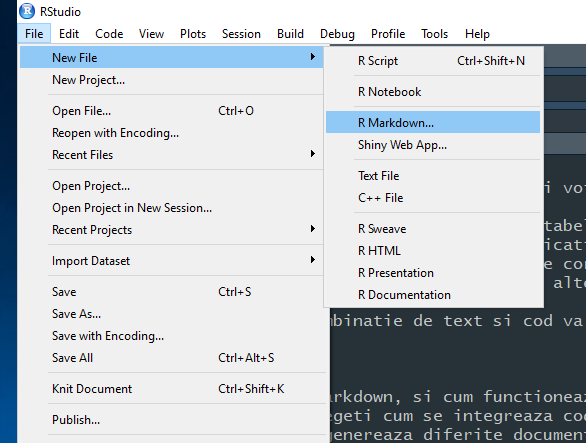
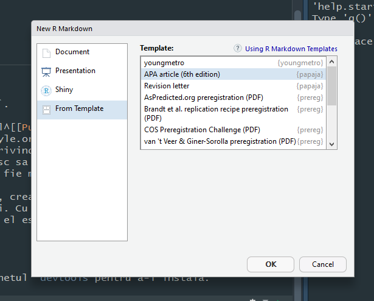

## Introducere

Acest workshop este dedicat invatarii `RMarkdown`, cu scopul de a genera documente reproductibile din punct de vedere computational.

Despre ce e vorba? Pe scurt, Rmarkdown va permite sa compilati datele, sintaxa si proza stiintifica intr-un singur document, urmatorul vostru articol, sau raport stiintific.

### Cui i se adreseaza?

1.  Cercetatorilor
2.  Studentilor
3.  Oricui implicat in predare...

### Scopul zilei de azi

- Care sunt cerintele unui instrument de prelucrare a textului.
- Sa invatati fundamentele sintaxei Markdown.
- Sa vedeti/intelegeti integrarea codului si prozei stiintifice in R+Markdown.
- Sa intelegeti cum se genereaza diferite documente (Word, PDF, HTML sau prezentari).
- Generarea tabelelor cu R/Markdown.
- Citari si referinte in Markdown.
- Generarea articole in format APA folosind pachetul `papaja` impreuna cu Markdown.

## Care sunt cerintele unui instrument de comunicare a rezultatelor stiintifice?

1.  Integrarea sintaxei si produsul ei final in document.

Separarea instrumentului de calcul de cel al procesarii textului in procesul de raportare creaza o falie ce trebuie trecuta *de fiecare data*. Doua lucruri se intampla obligatoriu aici: *copy-paste* si/sau actualizarea manuala. Dar *Copy-paste* este obositor si inclinat spre erori, ceea ce duce catre introducere manuala a datelor.

> **Nota**: peste 10% din pragurile de semnficatie nu corespund statisticilor din textul respectiv, iar 1.6% din valorile *p* sunt tratate incorect, adica textul stiintific si valoarea *p* nu corespund.^[[@nuijten2016]]

In ceea ce priveste actualizarea manuala, imaginati-va ca raportul dv. cuprinde 50 de diagrame, o serie de tabele, figuri si o serie intreaga de cifre. Aveti aproximativ 100 de clienti ce necesita raportul saptamanal. Rezultatele trebuie generate in acelasi timp cu textul.

2.  Continutul primeaza

Continutul are prioritate iar formatarea este, ca importanta, de ordin secundar. Un instrument orientat spre editare vizuala risca sa schimbe focus-ul dinspre continut spre decorul continutului.

Suplimentar, ar fi ideal daca instrumentul se ocupa singur de toate aspectele formatarii. Cu toate astea, autorul trebuie sa aiba acces la o serie intreaga de optiuni suplimentare.

3.  Utilizare usoara

Cu toate ca indeplineste o serie din conditiile enumerate, $\LaTeX$, sau HTML nu sunt simplu de invatat si utilizat. Dimpotriva.

4.  Compatibilitatea cu standarde uzuale (.pdf, .doc, etc.)

Cele mai populare standarde pentru rapoartele create sunt cu singuranta: .pdf, .doc, sau .ppt. In ultimul timp si HTML si EPUB, iar ele sunt de acum obligatorii.

De ex. ubicuitatea tabletelor si cititoarelor pe hartie electronica implica metode diferite. Un document creat pentru tablete sau hartie electronica necesita linii ce se pot rupe independent in functie de rezolutia (ceea ce EPUB si HTML pot sa o faca nativ, dar nu si .pdf).

Un mic bonus: acelasi text poate fi folosit pentru diverse scopuri cu un minim efort.

5.  Documentul astfel pregatit sa fie multumitor *dpdv* estetic.

6.  Sa fie utilizabil indiferent de platorma de utilizare si de timpul utilizarii.

Problema nu este imediat evidenta, insa evolutia soft-ului in timp o va face simtita.

Experiment: incercati sa deschideti fisiere output SPSS de acum 15 ani si raportati starile emotionale prin care treceti.

7.  Sa fie "puternic," i.e., sa fie flexibil si sa aiba functii diverse.

8.  Sa fie gratis.

9.  Sa usureze colaborarea.

10. Sa permita versionarea.

## Software necesar

1.  R^[<https://cran.r-project.org/>]

2.  RStudio^[[https://www.rstudio.com/](https://www.rstudio.com/products/rstudio/download/)]

Optional (si nu prea):

3.  Miktex^[<https://miktex.org/>] (Pt. generarea fisierelor .pdf), sau pachetul tinytex.

4.  Sau Tinytex^[Tinytex este, spre deosebire de Miktex, un pachet R]

## Creearea unui document Markdown...

... nu poate fi mai simpla:

{fig-alt="Meniul RStudio File > New File > R Markdown."}

## Structura unui fisier .Rmd (`R`Markdown)

1.  Header (YAML)
2.  Text
3.  Cod `R`

### 1. Header (YAML)

"Head"-erele in fisierele Markdown contin date, informatii despre documentul in care lucrati, si determina o serie de proprietati ale acestuia. In exemplul de mai jos, care este si cel mai simplu cu putinta, YAML contine informatii despre titlu, autor, data^[Pro-tip: folositi functia `Sys.Date()` pentru generarea automata a datei.] si a tipului de fisier dorit.

``` yaml
---
title: "Cum se zice corect: Iran sau Irak?"
author: "George"
date: "Mai 11, 2019"
output: html_document
---
```

Daca doriti un fisier de tip '`.pdf` aveti nevoie de software suplimentar.^[E vorba de TEX, pe care il puteti gasi la urmatoarea adresa <https://miktex.org/>] O alta solutie este un pachet R, numit Tinytex, ce se instaleaza din interfata R.

### 2. Textul in Markdown

Dupa YAML, *Textul* este a doua componenta principala. Aici va scrieti proza stiintifica, adnotat cu *Markdown* (explicat ceva mai jos). Partea frumoasa este ca puteti combina codul `R` cu textul. In felul urmator:

Incepeti codul din cadrul textului cu `` `r ``, dupa care inserati codul dorit si inchideti cu `` ` ``.^[Accentul grav (engl. *Backtick*) este un semn diacritic folosit in grafierile mai multor limbi contemporane, precum catalana, franceza, etc. Functia sa principala in cazul nostru este de a delimita codul `R` de text.] Un cod `R` `` ` r 1+1` `` va fi rulat odata cu textul, iar rezultatul va fi afisat automat = `r 1+1`. Vreti sa calculati 27 la puterea a 2-a? Nimic mai simplu: scrieti `` ` r 27^2` ``, care va produce = `r 27^2`.

### 3. Codul `R`

A treia componenta este codul `R`. Codul se insereaza prin `Code->Insert code chunk` sau combinatia de taste: `CTRL+ALT+I`. Codul `R` atasat Markdown, poate lua doua forme:

1.  *Inline* (in cadrul textului) - destinat calculelor simple, sau redarii unor valori.

> Our sample is made out of `` ` r nrow(esantion)` `` individuals.

2.  *Chunk* (bucati mari) - ce pot contine calcule complexe, imagini sau tabele.

> ```` ```{r} fit <-lm(Ozone ~ Solar.R + Wind, data = airquality)``` ````

### Exercitii (\~10min)

1.  Creati un nou fisier Markdown si salvati-l intr-un dosar dedicat.
2.  Alegeti in `YAML` ce fel de document doriti sa creati : `.html`, `.pdf`, etc.
3.  "Crosetati-l" si observati ce se intampla in *dosar*^[In Markdown, fisierele create si dependente se afla tot timpul in locul unde se afla si fisierul *.rmd*. De aceea locatia lor este relativa.] Alegeti cu atentie locul unde veti rula codul.
4.  Introduceti cateva bucati de cod (de exemplu, incarcati niste pachete - oricare dintre ele).

## Sintaxa Markdown

### Formatarea textului

Markdown este una dintre cele mai simple si usoare forme de adnotare a textului. Este un standard deschis, ce poate fi convertit in `.tex`, `.docx`, `.html`, `.pdf`, etc si este atat de usor incat il puteti [invata in aproximativ 5 minute!](https://learnxinyminutes.com/docs/markdown/) Nu, chiar pe bune.^[<https://learnxinyminutes.com/docs/markdown/>] Exista si alte linkuri utile precum [acest PDF](https://www.rstudio.com/wp-content/uploads/2015/02/rmarkdown-cheatsheet.pdf).

Limbajul este pe cat de usor, pe atat de puternic. Iata cateva exemple:

- E usor sa formatezi: `*italic*` sau `**aldin**`.
- Titluri prin `#titlu` pentru primul nivel, `##titlu2` nivelul 2, si `###titlu3` pentru nivelul 3.
- Listele sunt create prin `*` pentru fiecare item.
- Linkuri externe, cam asa:`[text](http://google.com)`.

Pentru o lista completa folositi **R Markdown Cheat Sheet**^[[Cheat Sheet](https://www.rstudio.com/wp-content/uploads/2015/02/rmarkdown-cheatsheet.pdf)]

### Exercitii (\~10min)

Luati un text oarecare (de ex: o pagina de pe wikipedia) si formatati-l cum credeti de cuviinta. Jucati-va cu toate optiunile posibile, de la ~~text taiat~~ pana la *italic* sau **aldine**. (Folositi "fituica" oferita de RStudio)

### Cum citam?

Citarea in RMarkdown este un proces destul de simplu, dar care trebuie tratat cu atentie. In principiu se folosesc ori Bibtex sau Biblatex, ambele standarde deschise. Cu toate astea, daca nu folositi deja un manager cum ar fi *Zotero*, va propun sa incepeti cu el.

Rmarkdown foloseste `pandoc-citeproc`, un filtru `pandoc` pe care-l aplica in ultimul pas al compilarii. Destul de tehnica explicatie, dar ideea (si avantajul) e ca functioneaza f. bine cu documentele Word si .pdf.

Pentru a incepe, adaugati numele fisierului ce contine bibilografia in parametrul `bibliography` din YAML, de exemplu (`bibliography: literatura_mea.bib`). Din acest moment, RMarkdown stie unde sa se uite dupa `[@james_1890]` si o va genera atat in text ca si la sfarsitul documentului: [@james_1890].

Citari multiple trebuie separate de un `;` (e.g., `[@james_1890; @bem_2011]`). Pentru a cita surse in text, nu le puneti in paranteze drepte; de exemplu; scrieti `@james_1890` pentru a cita [@james_1890].

| *Tip citare*        | *Sintaxa*                  | *Cum arata?*             |
|:--------------------|:---------------------------|:-------------------------|
| Citare in paranteza | `[@james_1890]`            | (James, 1890)            |
| Citari multiple     | `[@james_1890; @bem_2011]` | (Bem, 2011; James, 1890) |
| Citari in text      | `@james_1890`              | James (1890)             |
| Doar anul           | `[-@bem_2011]`             | (2011)                   |

### Tabelul in Markdown

In functie de ce doriti sa obtineti in RMarkdown, aveti la dispozitie o serie de instrumente:

1.  Pentru ceva extrem de simplu si rapid: formatarea Markdown

``` markdown
| A | B | C |
|:--|:--|:--|
| D | E | F |
| G | H | I |
```

cu urmatorul output:

| A | B | C |
|:--|:--|:--|
| D | E | F |
| G | H | I |

2.  Pentru pagini web (HTML) sau ceva mai simplu, pachetul `knitr` ofera functia `kable` - tabele rezonabile cu un efort minim. Optiunea `digits` va ofera ceva control pentru rotunjirea cifrelor.

```{r}
#| message: false
library(kableExtra)
kable(head(mtcars), digits = 2)
```

3.  Pentru materiale ceva mai pretentioase (de ex: rapoarte de cercetare), pachetul `stargazer`^[[Link catre manual](https://cran.r-project.org/web/packages/stargazer/vignettes/stargazer.pdf)] va da rezultate foarte bune. Partea puternica: estetica pentru modele complicate si o curba de invatare lina.

*Atentie*: functia `stargazer` cere optiunea `results="asis"` in cod.

```{r}
#| eval: false
fit    <- lm    (Ozone ~ Solar.R, data=airquality)
fit2   <- update(fit ,.~. + Wind, data=airquality)
stargazer::stargazer(fit, fit2)
```

produce

3.  Formatul *APA*. Aici lucrurile devin ceva mai complicate intrucat exista solutii diferite pentru probleme asemanatoare (dar totusi diferite (?!):

- Putin in afara scopului acestui workshop: daca doriti doar sa generati usor si rapid tabele Word in format *APA* folositi cu incredere `apaTables`. De la tabele de corelatii, pana la ANOVA sau regresii, acest pachet le ofera pe toate.

- Pachetul `papaja` ofera functia proprie `apa_table()`. Puteti folosi si pachetul `xtable`^[[Galerie Xtable cu exemple de cod](https://cran.r-project.org/web/packages/xtable/vignettes/xtableGallery.pdf)], extrem de puternic, *dar* acesta din urma nu ofera sprijin pentru documente *Word* si este mai dificil de invatat. Cu putin efort si Google insa puteti sa-l stapaniti.

### Grafice

Graficele sunt mult mai usor de produs si integrat decat tabelele. Unele sunt extrem de simple, cum ar fi o histograma

```{r}
hist(AirPassengers, breaks=5)
```

altele ceva mai complexe, de exemplu reprezentarea grafica a unei interactiuni cu pachetul `ggplot`.

```{r}
#| message: false
#| warning: false
library(ggplot2)
library(dplyr)
tips    <- read.csv("https://sebastiansauer.github.io/data/tips.csv")
qplot(x = total_bill, y = tip, data = tips, color = sex) +
  geom_smooth(method = "lm")
```

Ca de obicei, exista o serie de resurse foarte bune atat online^[<https://www.statmethods.net/graphs/index.html>] cat si pe hartie^[[@chang2012]] ce trateaza problema graficelor in RMarkdown.

### Ecuatii

Situatiile in care va trebui sa raportati formule sunt mai rare, dar exista. Aici intervine $\LaTeX$. Codul trebuie inchis si deschis cu `$`, iar rezultatul va arata in felul urmator $d' = z(\mathrm{H}) - z(\mathrm{FA})$. Exista si ecuatii mai complicate, aici veti folosi `$$` pentru a deschide si inchide formula.

$$\frac{n!}{k!(n-k)!} = \binom{n}{k}$$

Codul latex poate fi destul de complex si greu de invatat, dar din fericire exista colectii intregi de formule online: aici.^[[Formule Latex](https://en.wikibooks.org/wiki/LaTeX/Mathematics)]

### Statistici

De exemplu, daca doriti sa includeti media si deviatia standard intr-un text, puteti folosi functia `printnum()` din pachetul `papaja` care va include valoarea numerica, o va rotunji si va elimina zero-ul din fata (cum cere formatul *APA*).

De exemplu, urmatorul cod:

> Marimea esantionului este de de *N*=`` ` r nrow(date)` ``. Varsta medie este de `` ` r printnum(mean(date$varsta))` `` ani cu o deviatie standard, *SD* = `` ` r printnum(sd(date$varsta))` ``.

va produce urmtorul rezultat:

> Marimea esantionului este de de *N*=6. Varsta medie este de 21.83 ani cu o deviatie standard (*SD* = 0.98).

## Documente in format *APA* cu ajutorul pachetului `papaja`.

Formatul `APA` este destul de dificil de stapanit. Manualul^[[Publication Manual of the American Psychological Association, Sixth Edition](http://www.apastyle.org/manual/index.aspx)] are peste 270 de pagini, cu o serie de informatii (uneori contradictorii) privind cerintele. Sabloane in format `.doc` circula pe internet, dar putine sunt cele care reusesc sa implementeze toti parametrii. Mai mult, la schimbul documentelor intre autori, sansele ca sablonul sa fie modificat sunt mari.

Frumusetea pachetului `papaja` este ca preia partea tehnica, creaza si formateaza documentele in stil `APA`, lasandu-va mai mult timp petnru crearea continutului. Cu toate ca pachetul nu este inca publicat pe CRAN (reteaua oficiala pentru pachete si distributii `R`), el este destul de stabil incat sa poate fi folosit in munca de zi cu zi.

### Instalarea `papaja`

Momentan, `papaja` se afla pe GitHub si aveti nevoie de pachetul `devtools` pentru a-l instala.

```{r}
#| eval: false
# Daca nu-l aveti instalat inca, pachetul devtools este necesar.
if (!"devtools" %in% rownames(installed.packages())) install.packages("devtools")

# Instalati papaja
devtools::install_github("crsh/papaja")
```

### Crearea unui document

Dupa instalarea pachetului `papaja`^[Manualul `papaja`: <https://crsh.github.io/papaja_man/index.html>], sablonul `APA` ar trebui sa apara in meniul destinat crearii de noi documente.

{fig-alt="Dialogul New R Markdown din RStudio, cu sablonul APA article (6th edition) din papaja selectat."}

### Cateva observatii:

- Principiul dupa care functioneaza `papaja` este identic cu cel pe care l-am observat impreuna in `Markdown`, cu mentiunea ca `papaja` ofera o anvelopa suplimentara de functii ce preia formatarea, referintele si analiza statistica in momentul "crosetarii" documentului si le transpune in stilul `APA`.

- Odata creat, documentul este prepopulat cu o serie de infomatii. Veti observa ca `YAML` (capul documentului) este ceva mai complex, dar auto-suficient de clar, iar in rest se pastreaza logica si sintaxa `Markdown`.

- *Atentie* `papaja` este capabil sa exporte atat in fisiere de tip `.docx` cat si in `.pdf`, dar exista anumite restrictii, unele dintre ele importante. Pentru ca sistemul Microsoft este proprietar, `pandoc`nu are acces la anumite functii de formatare. De exemplu, in documentele Word, imaginile (figurile) nu vor putea fi aranjate la sfarsitul documentulu (asa cum cere stilul `APA`).

### Analiza statistica in `papaja`

`papaja` aduce cateva functii noi ce faciliteaza raportarea analizelor statistice. Poate cea mai importanta este functia `apa_print()`. Aceasta functie preia continutul obiectelor din `R`, si le transforma text ce poate fi inserat in document.

Sa vedem un exemplu:

```{r}
#| message: false
library(papaja)
# regresie lineara
modelfit  <-  lm(Ozone ~ Solar.R + Wind, data = airquality)
#functia apa_print() preia obiectul "lm" si-l transforma/salveaza
result    <-  apa_print(modelfit)
```

Rezultatele ar putea fi scrise in felul acesta,

> The analysis shows that the levels of Solar radiation significantly predict the levels of ozone concentration (`` ` r result$estimate$Solar_R` ``), (`` ` r result$statistic$Solar_R` ``). Moreover, the same effect can be observed in regard to the levels of wind intensity (`` ` r result$estimate$Wind` ``), (`` ` r result$statistic$Wind` ``).

care va produce urmatorul text:

> The analysis shows that the levels of Solar radiation significantly predict the levels of ozone concentration (`r result$estimate$Solar_R`), (`r result$statistic$Solar_R`). Moreover, the same effect can be observed in regard to the levels of wind intensity (`r result$estimate$Wind`), (`r result$statistic$Wind`).

Pentru unele obiecte R, `apa_print()` poate genera tabele, dar aici poate pachetele descrise ceva mai sus, au un usor avantaj.

### Exercitiu

Instalati pachetul `papaja`, deschideti un sablon nou, salvati documentul si *"crosetati-l"*.

1.  Includeti cateva elemente de text, precum si cateva calcule folosind atat cod inline cat si bucati mari de cod.

2.  Introduceti un grafic, oricare.

3.  "Crosetati" si observati schimbarile.

### Sessioninfo()

```{r}
sessionInfo()
```
